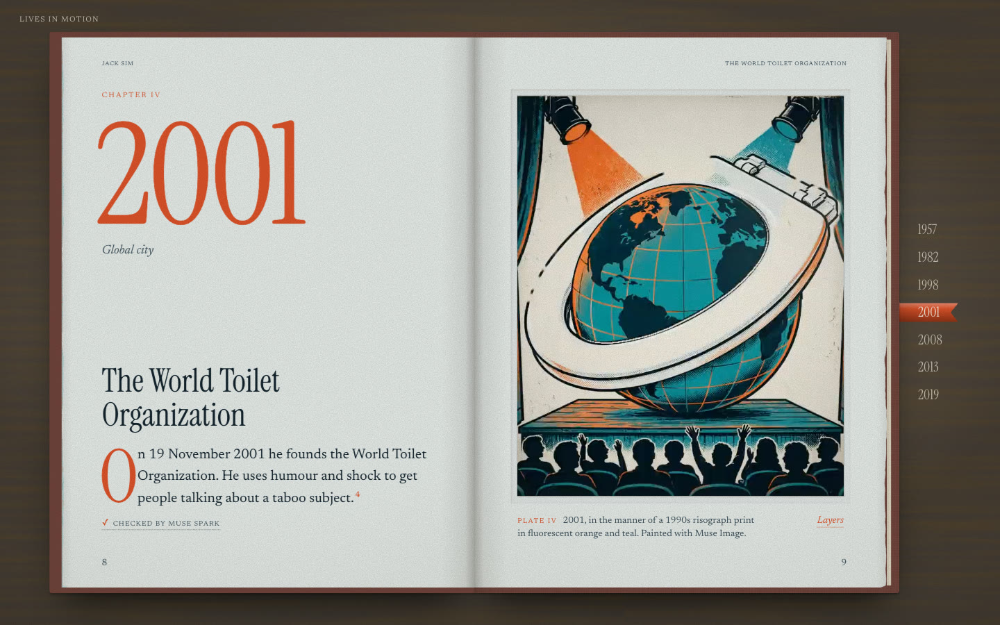
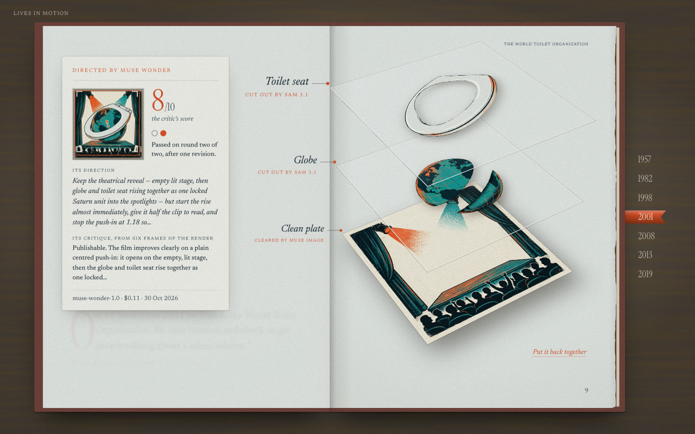
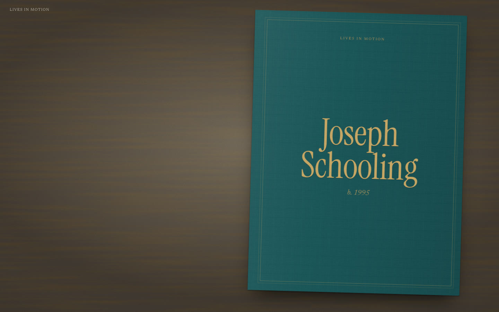
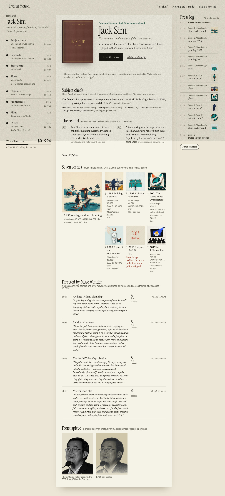

# Lives in Motion

Singaporean lives as illustrated books you read a page at a time. Each life is its own book: a
cloth cover, a frontispiece drawn in pen lines, then one spread per chapter, with a caption on the left
and on the right a plate painted in the print style of its decade, cut into layers that move in a
short film when the page turns open. Every caption is footnoted with its sources. The books are
made with Meta's **Muse Spark**, **Muse Image**, **SAM 3.1** and **Muse Wonder**, which directs
each film and critiques it. It was built for the Meta Global AI Developer Hackathon
(Oct 27 – Nov 4, 2026). Later, the same pipeline could grow into a larger gallery of
biographies.

On the shelf:

| Life | Text | Pictures and films |
|---|---|---|
| Jack Sim, "Mr. Toilet" (b. 1957) | Hand-curated from cited sources; every caption checked by Muse Spark | Muse Image + SAM 3.1, films directed by Muse Wonder |
| Joseph Schooling (b. 1995) | Hand-curated from cited sources; every caption checked by Muse Spark | Muse Image + SAM 3.1, films directed by Muse Wonder |
| Tan Howe Liang (1933–2024) | Researched and storyboarded by Muse Spark on `/create`; checked by Muse Spark | Muse Image + SAM 3.1, films directed by Muse Wonder |

Lee Kuan Yew's book is withdrawn from the shelf (`"listed": false`). Its files are kept and the
withdrawal is reversible (`pnpm approve lee-kuan-yew`).

| | |
|---|---|
|  |  |
| A spread: caption on the verso, the plate and its film on the recto | **Layers** (press L): Muse Image clean plate, SAM 3.1 cut-outs, Muse Wonder's direction |
|  |  |
| The book change, from Jack Sim's last page into Joseph Schooling | `/create`: subject check, plates, cut-outs and Muse Wonder's direction (a rehearsal) |

More in [`docs/shots/`](docs/shots/) (`pnpm shoot http://localhost:3000 docs/shots`).

## Run it

```sh
pnpm install
cp .env.example .env    # MODEL_API_KEY: one key covers Muse Spark, Muse Image, SAM 3.1, Muse Wonder and Muse Voice Transcribe
pnpm dev                # shelf at /, a book at /jack-sim, the workbenches at /create and /family
pnpm test               # schema, sources, eras, SAM decoding, budget guard, /create guard rails, subject screen, Wonder plans, cost of a life
pnpm typecheck
pnpm check              # typecheck, tests and a production build
```

## The book

The site is one illustrated biography. Home is the front matter and the shelf. Each life opens
from its cloth cover on a fixed stage and turns one page at a time: one wheel flick, swipe or
←/→ turns one leaf (CSS 3D page turns, a ribbon bookmark on the year rail, `#p=N` links to a
spread). The verso has the chapter, year, drop-cap caption and endnote marks. The recto has the
scene's plate; when the page opens, its film plays through once (the camera and layer moves Muse
Wonder directed) and its last frame holds while you read. Press **L** (or the Layers button) to
take the plate apart into the Muse Image clean background and its SAM 3.1 cut-outs. Notes and
picture credits close each book, and the last page closes the book, slides it out and opens the
next life. Desktop only for now. The code is in `components/book/`.

## How a life is made

```
name ─▶ screen ─▶ research ─▶ storyboard ─▶ illustrate ─▶ segment ─▶ films ─▶ direct
        Muse      Muse Spark    Muse Spark    Muse Image    SAM 3.1     local    Muse Wonder
        Spark     + web search  json_schema   era style,    cut-outs +  sharp +  plans each move,
        + search  cited facts   7 scenes      plate 1 as    Muse Image  ffmpeg   watches 6 frames,
                                              reference     clean plate          revises; flags plates
                       verify: Muse Spark + web search re-checks every caption
```

```sh
pnpm make jack-sim --name "Jack Sim" --hint "founder of the World Toilet Organization" --stages research,storyboard
pnpm make jack-sim --stages verify                  # fact-check every caption → verify.json + scene.checked
pnpm make jack-sim --stages illustrate,segment --scenes s4   # redo one scene
pnpm video jack-sim                                 # films, no API calls (follows motion.json where Wonder wrote one)
pnpm wonder jack-sim --dry                          # what Muse Wonder would send, and the worst-case cost
pnpm wonder jack-sim --scenes s6                    # direct + critique one scene (2 revisions at most)
pnpm wonder jack-sim --fix-plates                   # re-roll every plate the critic flagged (3 attempts at most)
```

- **Subject check** (`/create` only, `pipeline/create/screen.ts`): the safeguard that only real
  people are made. One Muse Spark call with web search (low context, about $0.05 and 10–20 s,
  through the budget guard) identifies the person and cites its sources. A life goes ahead only
  if the person is real, Singaporean or Singapore-linked, an adult, and documented by at least 2
  independent reputable sites (social media, video and people-search sites don't count). It
  declines fictional or unverifiable names and jokes, private individuals, minors, politicians,
  heads of state, military figures, lives defined by war, conflict or crime, and names that match
  several people (it asks for a hint). Names in `pipeline/create/blocklist.json` (takedowns) are
  declined before any call. The workbench shows the decision, the reason and every source found;
  a declined name is not researched or saved.
- **Research:** Muse Spark on the Responses API with `web_search`. Each `YYYY | fact` line keeps
  the `url_citation`s that overlap it, and uncited lines are dropped. Fewer than 7 cited facts
  stops the run.
- **Storyboard:** Muse Spark with a strict JSON schema. Scene sources are copied from the cited
  facts it names, never from the model's own claims. The prompt steers scenes away from politics,
  war and violence.
- **Verify:** Muse Spark with web search fact-checks each caption. Each verdict (`ok`,
  `disputed` or `corrected`), with its model, time and cited URLs, is stored in the scene's
  `checked` field and in `stories/<slug>/verify.json`.
- **Illustrate:** Muse Image, one square plate per scene, prompted with the era preset's print
  technique and palette. Plate 1 is the style reference for the rest.
- **Segment:** SAM 3.1 cuts out each concept ("toilet", "globe") as an alpha cut-out placed where
  it was found. A Muse Image edit then repaints the clean background behind it.
- **Frontispiece:** a credited photo, or a Muse Image emblem for lives made on `/create`. A SAM 3.1
  mask is traced into pen strokes by linedraw and drawn stroke by stroke with vivus.
- **Films:** `pipeline/video.ts` renders a 3.5 s film per scene locally with sharp and ffmpeg
  (every frame a keyframe, so seeking back on a backward turn is instant). Without a plan it is a
  fixed depth push; with one it follows `motion.json`.
- **Direct (Muse Wonder):** `pipeline/wonder.ts`. The director sees the plate, the clean
  background and each cut-out with its box, reads the caption, and returns a strict-schema plan
  that tells the scene's story: a reveal, a layer entrance, a pull-back for a loss, a rise for a
  triumph. The renderer clamps it and damps any move that would take a layer out of frame. The
  film is rendered, six frames go back to Wonder as a contact sheet, and the critic scores it
  against a plain push-in (5) with a pass mark of **8**, listing film issues and a revised plan.
  At most 2 revisions on the CLI, 1 on `/create`. The best round is published even below 8 if it
  beats a push-in, and the scene's rationale, score and rounds are kept in `motion.json` and
  `wonder.json`.
- **Plate critic (Muse Wonder + Muse Image):** the critic also reports plate defects (stray text,
  faces, off-era, a mangled subject). `--fix-plates` re-rolls each flagged plate with Muse Image,
  at most 3 attempts, plate 1 as the style reference and the art direction rewritten by Wonder's
  last verdict. Wonder judges the old plate and every attempt, the best is kept, cut out again with
  SAM 3.1 and directed again. The re-roll is recorded as `plateFix` in `wonder.json`.

## Make a new life (`/create`)

Type a Singaporean's name (plus an optional hint, and a photo you have the right to use) and
watch the models work. The workbench shows:

- the subject screen's verdict;
- Muse Spark's cited facts as they arrive;
- seven plate slots filling as Muse Image paints them;
- SAM 3.1 cut-outs lighting up over each plate;
- **Muse Wonder** directing the films: each scene's rationale, critic score and cost;
- a press log naming the model and cost of every artifact.

*Read the book* opens `/<slug>` as soon as the first plate exists. A real run takes about 10–15
minutes (the Direct step adds about 3) and costs about **$0.99**: the Muse Spark subject check $0.05, research $0.14 and storyboard $0.03; Muse Image and SAM 3.1 plates, cut-outs and the frontispiece $0.19; Muse Wonder directing six films $0.59 (2026-10-30; the helper recomputes it as runs land). That figure
comes from one helper, `lifeCost()` in `lib/cost.ts`, which reads the real `/create` runs' job
files and the ledger's Muse Wonder calls; the home page, the workbench and the rehearsal all quote
it.

**Public by default.** A life made on `/create` goes straight onto the shelf. Takedowns:
`pnpm approve --withdraw <slug>` takes a book off the shelf (its URL still opens), `pnpm approve`
lists the books that are off it, and adding the name to `pipeline/create/blocklist.json` stops it
being made again. Books made in family mode stay private.

**Rehearse for free.** In development, or with `CREATE_MOCK=1`, the *Rehearse* button replays
Jack Sim's finished life through the same events, including a declined scene, a retried call and
Muse Wonder's real rationales and scores for his films. Its costs add up to the same `lifeCost()`
figure.
It runs under Jack Sim's own name, needs no name typed, makes no Meta calls and charges nothing.

Guard rails, because a public page that spends real money is a risk:

- Real runs are on only when `NODE_ENV !== "production"` or `ALLOW_CREATE=1`. `CREATE_TOKEN`
  adds a passcode. Rehearsals need neither.
- One life at a time (409).
- 2 real lives a day per visitor (`CREATE_PER_IP_DAILY`, 429). Rehearsals are not counted. A
  visitor is told apart by `X-Forwarded-For` only with `TRUST_PROXY=1`, behind a proxy that
  overwrites the header (Vercel, nginx). Without it the header could be spoofed, and Next's route
  handlers don't expose the socket address, so all visitors share one bucket: 2 lives a day for
  the whole site.
- A run is refused if the budget guard has less than $2 of headroom (402), or if today's
  `/create` spend plus one life's $2 ceiling would pass `CREATE_DAILY_USD` (default $10, 429).
  Past the ceiling, Muse Wonder stops and the remaining films keep their fixed move.
- Name ≤ 80 characters, hint ≤ 120, no links or markup.
- Photos ≤ 8 MB, JPEG, PNG or WebP checked by their bytes, re-encoded (EXIF and GPS dropped), and
  accepted only with the rights box ticked.

Code: `pipeline/create/` (runner, rehearsal, subject screen, job types) on the job runner and
guard rails shared with family mode in `pipeline/jobs/`, `app/api/create/` (routes, including
Server-Sent Events) and `app/create/` with `components/create/` (the page).

## Budget

The event allowance is $150. Every Meta call goes through `pipeline/budget.ts`. It prices the
call's worst case, refuses the call if the ledger would pass **$135** ($15 is kept in reserve),
and records the real cost from the response's usage in `spend.jsonl` (committed). `pnpm spend`
prints the totals.

## Models used and why

| Model | Used for | Why this model |
|---|---|---|
| Muse Spark | Research (with web search), storyboard, `/create` subject screen, caption fact-check | Cited web answers for facts; strict JSON schema for the storyboard and the screen |
| Muse Image | Scene plates, clean plates (edit), the frontispiece emblem, plate re-rolls | Era print styles with plate 1 as a style reference, and "remove this, change nothing else" edits |
| SAM 3.1 | Scene cut-outs, portrait and emblem masks | Text-prompted segmentation ("globe", "person") that gives the layers and the pen-line masks |
| Muse Wonder | Film director and critic, plate critic | Reads several images at once (plate, clean plate, cut-outs, a contact sheet of its own film) and answers in a strict schema |
| Muse Voice Transcribe | Family mode: the recording, as timed turns with speaker labels | Turn-level timestamps, so every fact in a family book cites the second it was said; English, Malay, Mandarin and Tamil, code-switched |

## Built during the hackathon

Everything in this repository was made during the event (Oct 27 – Nov 4, 2026). Nothing predates
it.

- **First commit:** `f8d2754`, 2026-10-30 00:13 JST (2026-10-29 15:13 UTC). The full timeline is
  in `git log --reverse`.
- **First paid Meta call:** 2026-10-30 01:25 UTC (`spend.jsonl`, line 1).
- **Hand-curated text:** the first commit's lives (Jack Sim, Joseph Schooling, Lee Kuan Yew) were
  written from cited sources (NLB Infopedia, the Straits Times, the UN, Wikipedia) before any Meta
  call. Their captions have since been fact-checked by Muse Spark. Tan Howe Liang's text is
  entirely model-made.

What each Meta model made, counted from the files and the ledger (2026-10-30):

| Model | Artifacts | Count |
|---|---|---|
| Muse Spark + web search | Tan Howe Liang's research: cited facts | 17 facts from 1 research call |
| Muse Spark (JSON) | Tan Howe Liang's storyboard: 7 scenes, tagline, emblem brief | 1 |
| Muse Spark + web search | Caption fact-checks (`verify.json`, `scene.checked`) for the three lives on the shelf | 21 (19 ok, 2 corrected) |
| Muse Spark + web search | `/create` subject checks (and the earlier search-free screen) | 2 test checks (1 confirmed, 1 declined), plus 1 earlier screen |
| Muse Image | Scene plates, era-styled, plate 1 as style reference | 28 (7 × 4 lives), plus 3 re-roll attempts for Jack Sim's 2001 plate (attempt 3 kept) |
| Muse Image (edit) | Clean backgrounds behind the cut-outs | 28, plus 2 redone for the re-rolled plate |
| Muse Image | Frontispiece emblem (Tan Howe Liang) | 1 |
| SAM 3.1 | Scene cut-outs (alpha WebP) | 36 |
| SAM 3.1 | Person masks for the three photo frontispieces, plus 1 emblem mask | 4 |
| Muse Wonder (director + critic) | Motion plans and critiques of the 15 illustrated films in the three books on the shelf (the 6 line scenes keep their own draw-on film) | 15 scenes: 8 pass the critic's mark of 8, 6 are published below it because they beat a push-in, 1 (Jack Sim 2013) keeps its fixed move |
| Muse Wonder (plate critic) | Plate defects flagged while critiquing; judging the re-rolled 2001 plate (6/10 before, 9/10 after) | 1 plate re-rolled, 4 judgements |

Muse Wonder made 146 calls for $5.23 in all (44 director, 98 critic, 4 plate judge), over two
rounds of direction. The 4 lives include Lee Kuan Yew, who is withdrawn. Made locally with no
model: 28 films (sharp + ffmpeg), 8 pen-line scene drawings and 4 frontispiece line drawings
(linedraw).

On the evening of 2026-10-30 the ledger had 408 calls and **$12.41** spent: Muse Spark with
search 34 calls, $5.72 (including a deep-research run); Muse Wonder 146, $5.23; Muse Image 91,
$0.91; SAM 3.1 124, $0.31; Muse Spark 8, $0.21; Muse Voice Transcribe 3, $0.02; other $0.003.
That is more calls than artifacts because of retries, misses, fallbacks and re-runs. `pnpm spend`
shows the live total.

### Third-party material

| What | Licence | Where |
|---|---|---|
| [linedraw](https://github.com/LingDong-/linedraw) by Lingdong Huang | MIT | Vendored in `pipeline/vendor/linedraw` (with its LICENSE), one option added |
| [vivus](https://github.com/maxwellito/vivus) | MIT | npm dependency; draws the line portraits |
| `@meta-sam/parser` | SAM License (Meta) | npm dependency; decodes SAM 3.1 masks |
| Fonts: Archivo, Instrument Serif, Newsreader, IBM Plex Mono | SIL OFL 1.1 | `next/font/google` |
| Jack Sim photo, by Clorox Toilet Products | [CC BY 2.0](https://creativecommons.org/licenses/by/2.0) | [Commons](https://commons.wikimedia.org/wiki/File:Jack_Sim_(WTO,_2010)_-_2.jpg) |
| Joseph Schooling photo, by Oleg Bkhambri (Voltmetro) | [CC BY-SA 4.0](https://creativecommons.org/licenses/by-sa/4.0) | [Commons](https://commons.wikimedia.org/wiki/File:Joseph_Schooling_Kazan_2015.jpg). The traced drawing, its mask and its WebP are shared under CC BY-SA 4.0 too. |
| Lee Kuan Yew photo, by the Australian News and Information Bureau | Public domain | [Commons](https://commons.wikimedia.org/wiki/File:Lee_Kuan_Yew_at_the_1969_Five_Power_Defence_Conference_(5).jpg) (life withdrawn) |

The photo credits are also in `pipeline/portraits/credits.json` and in each book's picture
credits. Figures in the plates are silhouettes or seen from behind, so no likeness of a real
person is generated.

## Rules the content follows

- Every scene cites at least one source, and the notes list them all.
- Figures are silhouettes or seen from behind. No faces are generated.
- No politicians, heads of state, or lives defined by war or crime.
- Captions stay under about 30 words. `prefers-reduced-motion` gets a still, readable book.

## Layout

| Path | What |
|---|---|
| `stories/<slug>/story.json` | The life: scenes, captions, sources, layers, fact-check verdicts, `listed` |
| `stories/<slug>/verify.json` | Muse Spark's fact-check of every caption, with cited URLs |
| `app/` | Next.js pages: home and shelf, one book per life, `/create`, `/family` and their APIs |
| `components/` | The book, scene art, films, line drawings, the `/create` and `/family` workbenches |
| `lib/schema.ts` | Story schema (zod), the contract between pipeline and site |
| `lib/stories.ts` | `allStories()` (the shelf), `getStory()`, `readingOrder()` (drafts open by URL) |
| `pipeline/` | Meta Model API client, budget guard, prompts, stages, SAM cut-outs, portraits, films (`pipeline/film/`), the `/create` and `/family` runners, CLIs |
| `spend.jsonl` | Ledger of every paid Meta call |

## Licence

MIT © 2026 ong6, for the code (see `LICENSE`). Third-party material keeps its own licence (above).
