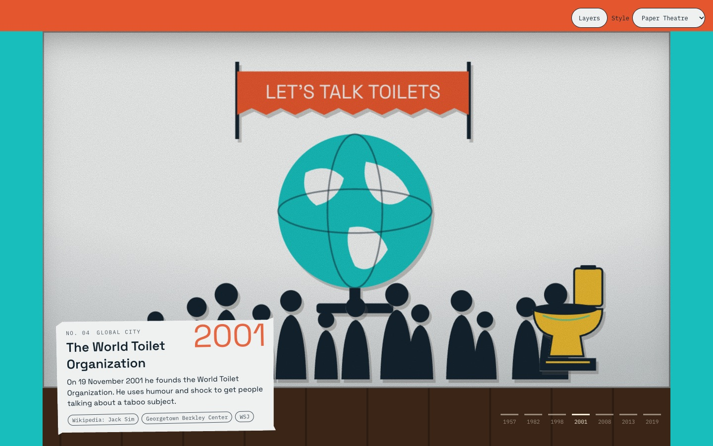
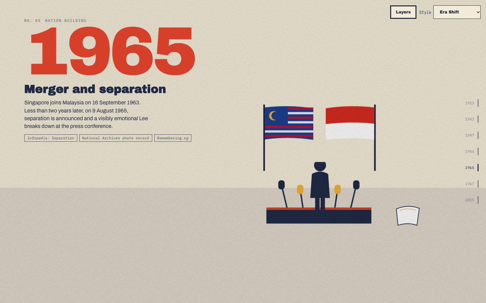
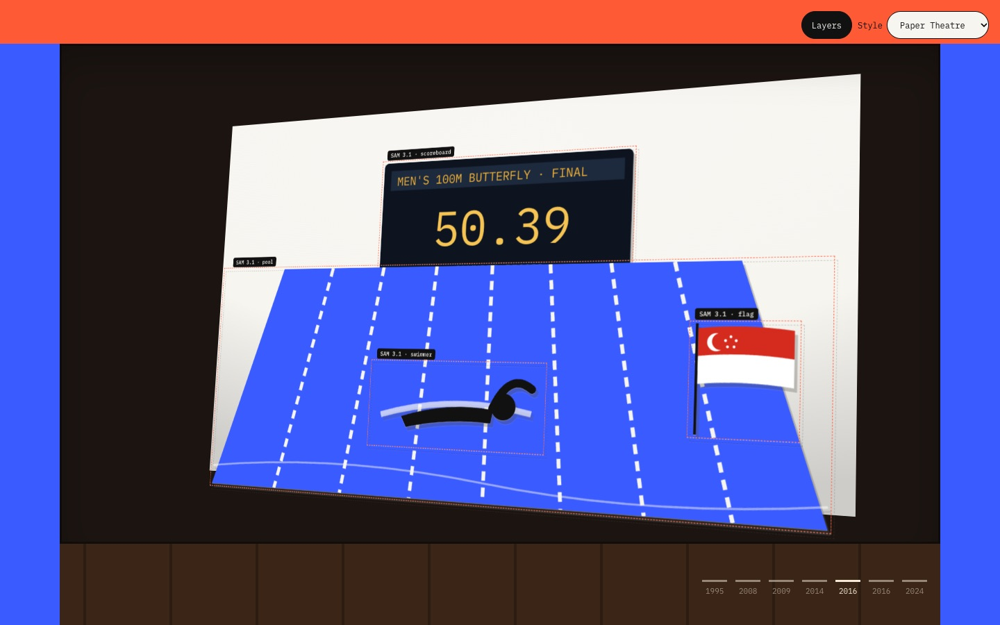

# Lives in Motion

Singapore lives told in motion. Each life is researched with cited sources, illustrated in the
print style of its era, cut into layers and animated as you scroll. Text narrates; the pictures
tell it. Built for the Meta Global AI Developer Hackathon (Oct 26 – Nov 4, 2026); it is the
seed of *theabgallery* (The Awesome Biography Gallery).

| Life | Era span | Status |
|---|---|---|
| Jack Sim, "Mr. Toilet" (b. 1957) | 1957–2019 | 7 cited scenes, built-in art |
| Lee Kuan Yew (1923–2015) | 1923–2015 | 7 cited scenes, built-in art |
| Joseph Schooling (b. 1995) | 1995–2024 | 7 cited scenes, built-in art |



| Era Shift (Lee Kuan Yew, 1965) | Layers x-ray (SAM 3.1 cut-outs) |
|---|---|
|  |  |

## Run it

```sh
pnpm install
pnpm dev          # gallery at /, a story at /story.html?p=jack-sim, directions at /styles.html
pnpm test         # schema, sources, eras, motifs, SAM decoding and cut-outs
pnpm build
pnpm shoot http://localhost:5173   # screenshots into docs/shots with the installed Chrome
```

Story URLs take `p` (slug), `d` (`paper-theatre` | `living-archive` | `era-shift`), `s` (jump
to scene n) and `layers=1` (open the x-ray view).

## How a life is made

```
name ─▶ research ─▶ storyboard ─▶ illustrate ─▶ segment ─▶ story.json ─▶ site
        Muse Spark   Muse Spark    Muse Image    SAM 3.1     (zod-checked)  GSAP scroll
        + web search  json_schema   era style +   one concept
        → cited facts → 7 scenes    1st plate as  per layer →
                       + layer plan  reference     PNG cut-outs
```

```sh
cp .env.example .env            # add MODEL_API_KEY (one key covers Spark, Image and SAM 3.1)
pnpm make jack-sim --name "Jack Sim" --hint "founder of the World Toilet Organization"
pnpm make jack-sim --stages illustrate,segment --scenes s4   # redo one scene
```

- **Research:** Muse Spark on the Responses API with `web_search`; each `YYYY | fact` line keeps
  the `url_citation`s that overlap it. Uncited lines are dropped; fewer than 7 facts stops the run.
- **Storyboard:** Muse Spark with a strict JSON schema. Scene sources are copied from the cited
  facts it names, never from the storyboard model's own claims.
- **Illustrate:** Muse Image, one 16:9 plate per scene, prompted with the era preset's print
  technique and palette. Plate 1 is passed as a reference to the rest so the series reads as one hand.
- **Segment:** SAM 3.1 finds each layer's concept ("toilet", "globe") on the plate; the mask
  becomes the alpha of a cropped PNG, placed where SAM found it. A concept SAM misses keeps its motif.

Until a story has been through the pipeline it renders with the built-in cut-paper motifs in
`src/motifs.ts`, so the whole site works offline and without a key.

## Rules the content follows

- Every scene cites at least one source; the footer lists them all.
- Figures are silhouettes or seen from behind: no generated likenesses of real people.
- Captions stay under ~30 words; `prefers-reduced-motion` gets a still, readable timeline.

## Layout

| Path | What |
|---|---|
| `stories/<slug>/story.json` | The life: scenes, captions, sources, layers |
| `src/schema.ts` | Story schema (zod), the contract between pipeline and site |
| `src/eras.ts` | Era presets: palette, type, grain, easing, print technique |
| `src/motifs.ts` | Built-in cut-paper SVG motifs |
| `src/render/` | Still frames and the scroll player |
| `src/styles/lim.css` | Stage plus the three design directions |
| `pipeline/` | Meta Model API client, prompts, stages, SAM cut-outs, CLI |
| `design-system/` | Builds the Claude Design design-system bundle (`pnpm design-system`) |
| `DESIGN.md` | Design directions, motion rules, hackathon plan |
